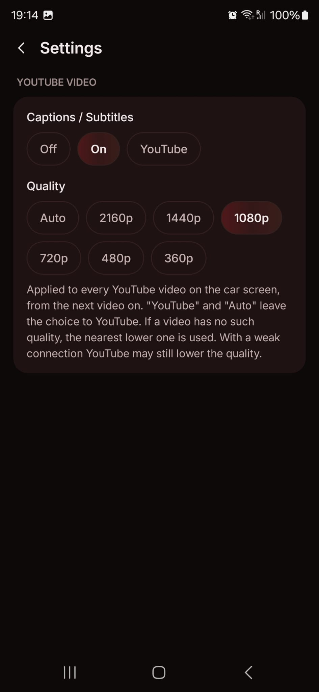

# TubeAUTO

TubeAUTO shows YouTube and other web pages on your Android Auto car screen. It uses GeckoView,
the browser engine of Firefox, with uBlock Origin built in, so pages load without ads.

- YouTube (m.youtube.com) on the car screen, in the right scale for the car display
- Tap, scroll and pinch to zoom on the car screen, full-screen video, seek by tapping the progress bar
- Search with the car's on-screen keyboard (YouTube and Google open the results directly)
- Buttons on the car screen: BACK, HOME (YouTube), GOOGLE (google.com), EXIT
- Sound through the car speakers
- YouTube video settings on the phone (menu > Settings): captions / subtitles Off, On or as set by
  YouTube; quality Auto, 2160p, 1440p, 1080p, 720p, 480p or 360p
- uBlock Origin built in, updated from the phone (menu > uBlock)
- Enabling in Android Auto from the app itself (needs Shizuku, see Install)

Watch only when parked. While driving, keep your attention on the road.

## Screenshots

| Android Auto app list | Phone: main screen | Phone: menu |
|---|---|---|
|  |  |  |

| Phone: Settings | Phone: uBlock |
|---|---|
|  |  |

## Download

Get the APK from [Releases](../../releases/latest) (file `TubeAUTO-<version>.apk`).

Requirements: Android 8.0 or higher, 64-bit ARM phone (arm64-v8a), Android Auto, and the free
app [Shizuku](https://github.com/RikkaApps/Shizuku) (only needed once, to enable TubeAUTO in
Android Auto).

## Install

Android Auto shows apps of this type only when they come from Google Play. TubeAUTO is not on
Google Play, so it marks itself as installed from Google Play with the help of Shizuku. The
"Unknown sources" option in the Android Auto developer settings does not help for this type of
app, you do not need it.

### 1. Install Shizuku

Install Shizuku from Google Play or from
[github.com/RikkaApps/Shizuku/releases](https://github.com/RikkaApps/Shizuku/releases).

### 2. Start Shizuku

Shizuku has to be running only while you do step 4. After a phone restart it is stopped again,
which is fine: start it again only when you need it (for example after a TubeAUTO update).

Without a computer (Android 11 or higher, phone connected to Wi-Fi):

1. Turn on Developer options: phone Settings > About phone > Software information > tap
   **Build number** 7 times.
2. Open Shizuku, under **Start via Wireless debugging** tap **Pairing**. Shizuku shows a
   notification for the pairing code.
3. Open phone Settings > Developer options > **Wireless debugging**, turn it on and tap
   **Pair device with pairing code**. Type the code shown there into the Shizuku notification.
4. Back in Shizuku, tap **Start**. Shizuku shows "Shizuku is running".

With a computer (any Android version):

1. Turn on Developer options (as above) and **USB debugging** in Developer options.
2. Connect the phone by USB to a computer with
   [adb](https://developer.android.com/tools/releases/platform-tools) and allow USB debugging on
   the phone.
3. In Shizuku, open **Start by connecting to a computer**, run the command shown there on the
   computer. Shizuku shows "Shizuku is running".

### 3. Install TubeAUTO

Download `TubeAUTO-<version>.apk` on the phone and open it. Android asks to allow installing apps
from this source (browser or file manager): allow it, then tap **Install**.

### 4. Enable TubeAUTO in Android Auto

1. Open TubeAUTO. At the bottom of the main screen the **Android Auto** card shows "Not enabled".
2. Tap **Enable in Android Auto**.
3. Shizuku asks for permission: tap **Allow all the time**.
4. On Android 14 and lower, Android asks to allow "Install unknown apps" for TubeAUTO: turn it on,
   go back to TubeAUTO and tap **Enable in Android Auto** again.
5. The Android installer opens: tap **Update**.
6. The card now shows **Ready**.

### 5. Start in the car

1. Connect the phone to the car (cable or wireless Android Auto).
2. Open the app list on the car screen and tap **TubeAUTO**. YouTube opens.
3. If TubeAUTO is not in the list: on the phone open Android Auto settings > **Customize
   launcher** and turn TubeAUTO on.

TubeAUTO registers as a navigation app, which is the only app type allowed to draw its own image
on the car screen. Use BACK, HOME, GOOGLE and EXIT at the side of the car screen.

## Updates

Download the new APK from Releases and install it over the old one. Settings, cookies and
uBlock settings stay.

After every update, open TubeAUTO and do step 4 again (start Shizuku first, step 2), because
installing the new APK removes the Google Play mark and Android Auto hides the app until it is
enabled again.

## Known issues

- Sometimes the car screen stays black after TubeAUTO starts. Briefly turn on the phone screen
  (press the power button once); the picture appears right away.
- Captions and quality from Settings are applied a few seconds after a video starts. Changes in
  Settings apply from the next video.
- Dark or light page theme: choose it in YouTube itself (YouTube settings > General >
  Appearance).

## Changes

See [CHANGELOG.md](CHANGELOG.md).

## Open source components

| Component | Author | License |
|---|---|---|
| GeckoView | Mozilla | Mozilla Public License 2.0 |
| uBlock Origin | Raymond Hill | GNU General Public License v3 |
| Android for Cars App Library | Google | Apache License 2.0 |
| Jetpack Compose, AndroidX | Google | Apache License 2.0 |
| Shizuku API | RikkaApps | Apache License 2.0 |
| UnknownAuto (install method) | GitMag | MIT License |
| Inter (font) | Rasmus Andersson | SIL Open Font License 1.1 |

## License

© 2026 Tomasz Pieczara. All rights reserved. The source code is published for reference only.
Copying, modifying, distributing or selling all or part of the code, in source or compiled form,
without the written permission of the author is prohibited. The app itself is free to download
and use. Parts taken from open source projects stay under their own licenses (see above).

## Contact

Bugs, ideas and questions: [Issues](../../issues) or tomasz.pieczara@gazeta.pl.
