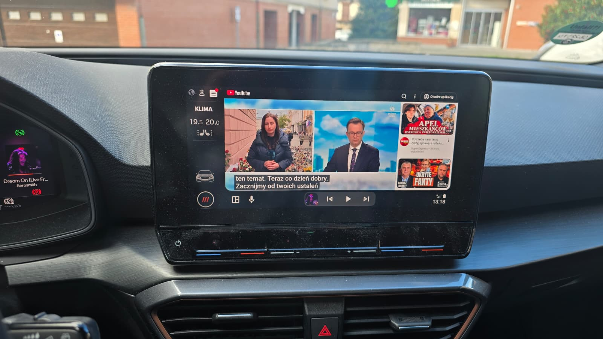
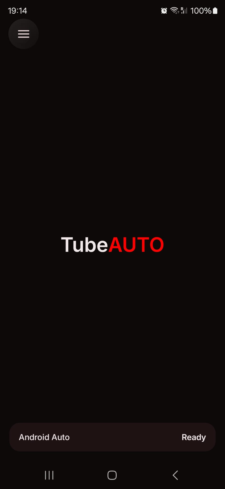
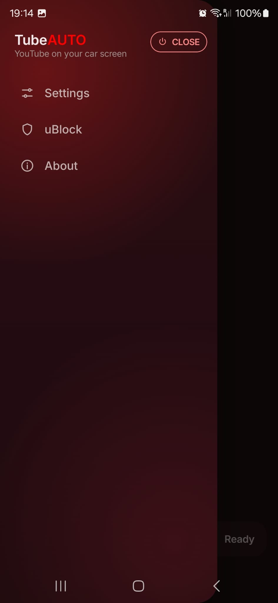
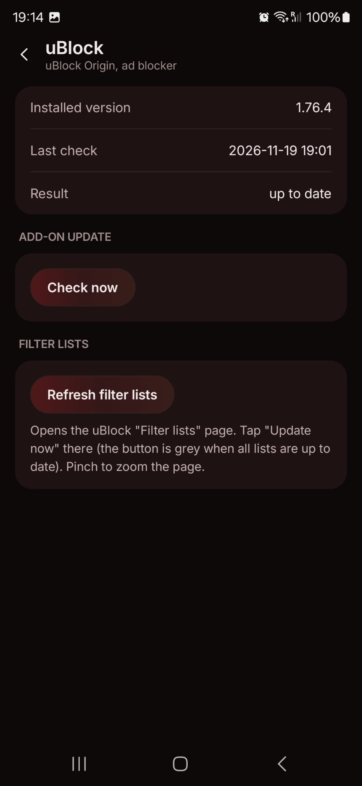
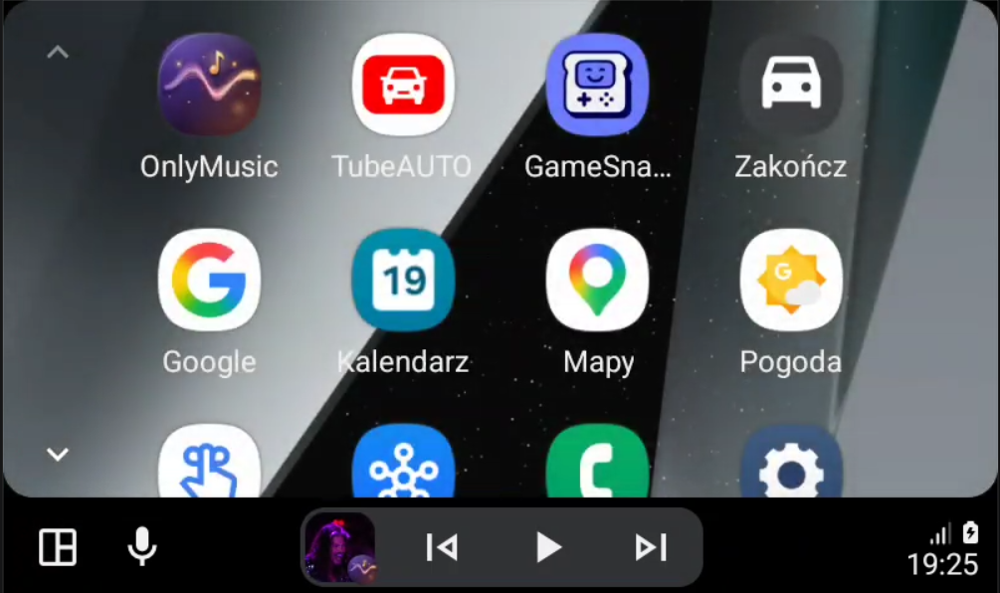

  

<h1 align="center">TubeAUTO</h1>

TubeAUTO shows YouTube and other web pages on your Android Auto car screen. It uses GeckoView,
the browser engine of Firefox, with uBlock Origin built in, so pages load without ads.

- YouTube (m.youtube.com) on the car screen, in the right scale for the car display
- Tap, scroll and pinch to zoom on the car screen, full-screen video, seek by tapping the progress bar
- Search with the car's on-screen keyboard (YouTube and Google open the results directly)
- Buttons on the car screen: BACK, HOME (YouTube), GOOGLE (google.com), EXIT
- Sound through the car speakers
- YouTube video settings on the phone (menu > Settings): captions / subtitles Off, On or as set by
  YouTube; quality Auto, 2160p, 1440p, 1080p, 720p, 480p or 360p
- uBlock Origin built in, updated from the phone (menu > uBlock)
- Enabling in Android Auto from the app itself (needs Shizuku, see Install)

Watch only when parked. While driving, keep your attention on the road.

## Screenshots

| Main screen | Menu | Settings | uBlock |
|---|---|---|---|
|  |  |  |  |

## Download

Download the [latest TubeAUTO](../../releases/latest).

Requirements: Android 8.0 or higher, 64-bit ARM phone (arm64-v8a), Android Auto and
[Shizuku from Google Play](https://play.google.com/store/apps/details?id=moe.shizuku.privileged.api).

## Install

**Step-by-step guide with screenshots: [INSTALL.md](INSTALL.md)**

You need two apps: Shizuku and TubeAUTO.

1. Install [Shizuku from Google Play](https://play.google.com/store/apps/details?id=moe.shizuku.privileged.api).
2. Open Shizuku and start it with **Start via Wireless debugging** (Shizuku shows you how).
3. Download the [latest TubeAUTO](../../releases/latest), open it and tap **Install**.
4. Open TubeAUTO, tap **Enable in Android Auto**, allow what Android asks, then tap **Update**.
   The card shows **Ready**.
5. Connect the phone to the car and open **TubeAUTO** from the car's app list.

Shizuku is only needed for step 4. After every TubeAUTO update, do step 4 again.

Problems?

- **Shizuku does not start without a computer:** connect the phone by USB to a computer with
  [adb](https://developer.android.com/tools/releases/platform-tools), turn on USB debugging, open
  **Start by connecting to a computer** in Shizuku and run the command shown there.
- **"Enable in Android Auto" says Shizuku is not running:** start Shizuku again (step 2). Shizuku
  stops after every phone restart.
- **TubeAUTO is not in the car's app list:** on the phone open Android Auto settings >
  **Customize launcher** and turn TubeAUTO on. Check that the card in TubeAUTO shows **Ready**.
- **The car screen stays black:** briefly turn on the phone screen (press the power button once).

## Updates

Download the new APK from Releases and install it over the old one. Settings, cookies and
uBlock settings stay.

After every update, open TubeAUTO and do step 4 again (start Shizuku first, step 2), because
installing the new APK removes the Google Play mark and Android Auto hides the app until it is
enabled again.

## Known issues

- Sometimes the car screen stays black after TubeAUTO starts. Briefly turn on the phone screen
  (press the power button once); the picture appears right away.
- Captions and quality from Settings are applied a few seconds after a video starts. Changes in
  Settings apply from the next video.

## Changes

See [CHANGELOG.md](CHANGELOG.md).

## Open source components

| Component | Author | License |
|---|---|---|
| GeckoView | Mozilla | Mozilla Public License 2.0 |
| uBlock Origin | Raymond Hill | GNU General Public License v3 |
| Android for Cars App Library | Google | Apache License 2.0 |
| Jetpack Compose, AndroidX | Google | Apache License 2.0 |
| Shizuku API | RikkaApps | Apache License 2.0 |
| UnknownAuto (install method) | GitMag | MIT License |
| Inter (font) | Rasmus Andersson | SIL Open Font License 1.1 |

## License

© 2026 Tomasz Pieczara. All rights reserved. The source code is published for reference only.
Copying, modifying, distributing or selling all or part of the code, in source or compiled form,
without the written permission of the author is prohibited. The app itself is free to download
and use. Parts taken from open source projects stay under their own licenses (see above).

## Contact

Bugs, ideas and questions: [Issues](../../issues) or tomasz.pieczara@gazeta.pl.
